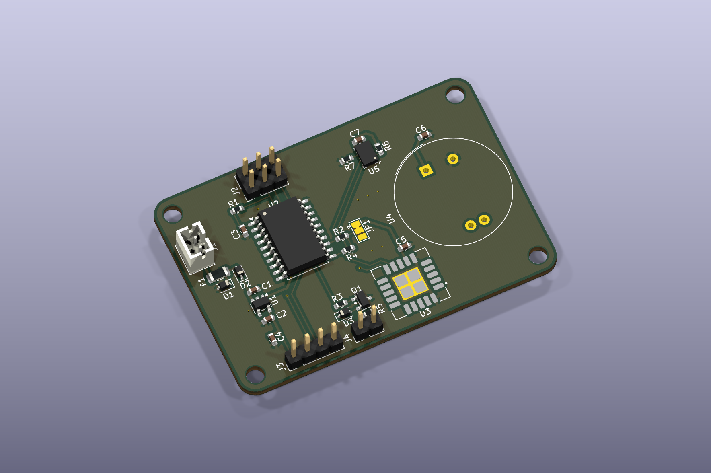

# Gas Sensor Breakout - Visual Guide

CAD views generated from the packaged source files using KiCad 10.0.5.

*Angled top view. The assigned U3 SCD40 and U4 LuminOX models are unavailable; their footprints remain present in the design.*

| Visual | Description |
| --- | --- |
| [3D CAD render](images/pcb-3d-render.png) | Angled top view using the available component models. |
| [Front PCB layout](images/pcb-front.svg) | Front copper, front silkscreen, and board outline; viewed from the top. |
| [Back PCB layout](images/pcb-back.svg) | Back copper and board outline; mirrored to show the underside. |
| [Main schematic](images/schematic-overview.png) | Sheet 1: power, controller, programming, and expansion interfaces. |
| [Sensor schematic](images/schematic-sensors.png) | Sheet 2: gas sensors, bus connections, and switched output. |
| [Complete schematic](../exports/schematic.pdf) | Both hierarchical sheets in their source order. |

*Front copper, front silkscreen, and board outline.*

*Back copper and board outline, mirrored to show the underside. No back silkscreen is present.*
